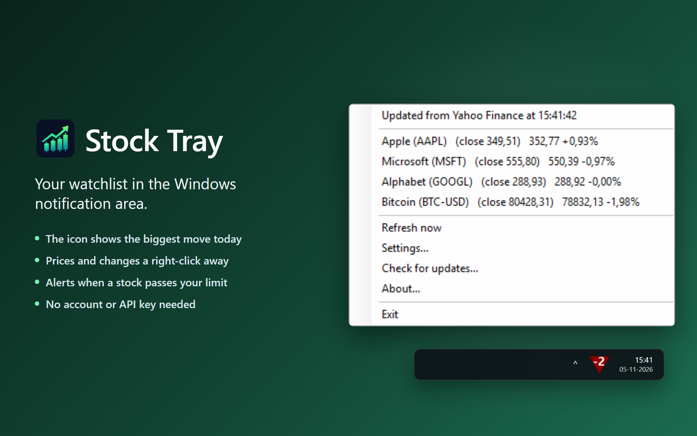

# Stock Tray

[](https://github.com/kreaton/StockTray/releases/latest)
[](LICENSE)




**Keep an eye on your stocks from the Windows notification area.**

The tray icon shows the biggest move in your watchlist, and a notification tells you when a stock moves more than you've chosen.

## Install

**[Download the installer](https://github.com/kreaton/StockTray/releases/latest/download/StockTray-win-Setup.exe)** and run it. If your PC doesn't have the .NET 10 Desktop Runtime yet, the installer adds it.

The installer isn't code-signed, so Windows may warn you about it. To continue, choose **More info → Run anyway**.

Windows may hide new tray icons behind the **^** arrow on the taskbar. Drag the icon out onto the taskbar to keep it in view.

To get a newer version later, right-click the icon and choose **Check for updates...**. To remove the app, use **Settings → Apps → Installed apps** in Windows.

## How to use it

Stock Tray starts with Apple, Microsoft and Alphabet on the watchlist and fetches their prices right away.

**The icon** shows the largest percentage move today, rounded to a whole number:

| Icon | Meaning |
|---|---|
| Red triangle pointing down | At least one stock is down |
| Green triangle pointing up | Nothing is down |
| Gray triangle with `$` | No prices yet |

Hover over the icon to see the best and worst performers.

**The right-click menu** lists each stock's previous close, current price and percentage change. Click a stock to open its Yahoo Finance page, or click the "Updated" line at the top to open the Yahoo Finance home page. Choose **Refresh now**, or double-click the icon, to update right away.

**Alerts** appear the first time a stock's move passes your limit, up or down. You won't get another alert for that stock until its move has dropped back under the limit and passed it again.

## Settings

Right-click the icon and choose **Settings...**.

- **Watchlist:** Yahoo Finance symbols such as `AAPL`, `BTC-USD` or `^GSPC`. To remove a stock, select its row and press Delete.
- **Display name:** an optional name to show instead of the symbol, for example "Apple" for `AAPL`.
- **Alert %:** how big a move triggers an alert for each stock. The default is 5%.
- **Check every:** how often prices are fetched. The default is 5 minutes.
- **Sound:** play a sound when an alert fires. On by default.
- **Start automatically when Windows starts.**
- **Links:** the pages opened from the menu, if you prefer another site to Yahoo Finance. In the per-stock link, `%ASIN%` is replaced with the symbol.

## Where the prices come from

Prices come from an unofficial Yahoo Finance service that needs no account or API key. Yahoo can change or limit it without notice, and quotes may be delayed, so don't rely on them for trading decisions. If a stock can't be fetched, it shows as "(unavailable)" and is tried again at the next check.

---

## For developers

The app is built with WinForms on .NET 10 and only runs on Windows. Installs and updates use [Velopack](https://velopack.io). Settings are saved to `%AppData%\StockTray\settings.json`.

Quotes come from `query1.finance.yahoo.com/v8/finance/chart/{symbol}`.

### Build and run

You need the [.NET 10 SDK](https://dotnet.microsoft.com/download). You can also open `StockTray.slnx` in Visual Studio and press F5.

```bash
dotnet run --project StockTray
```

### Releases

Every push to `main` builds the app on GitHub Actions and publishes a new release, one patch version higher than the last (`.github/workflows/release.yml`). To push without releasing, add `[skip ci]` to the commit message. You can also start a release by hand from the repository's Actions tab, or run `StockTray\BuildRelease.ps1` locally. Add `-LocalOnly` to build without uploading.

The repository must stay public, because **Check for updates...** reads its releases without logging in.

### Source files

All of these are in the `StockTray` folder.

- `Program.cs`: entry point, starts the tray application
- `TrayApplicationContext.cs`: polling, tray icon, menu, alerts and updates
- `YahooFinanceClient.cs`: fetches and parses a quote for one symbol
- `Quote.cs`: a price snapshot, or the error, for one symbol
- `SettingsForm.cs`: settings dialog
- `AboutForm.cs`: about dialog
- `StockSettings.cs` and `TickerConfig.cs`: settings, loaded from and saved to JSON
- `AutoStartManager.cs`: the "start with Windows" option
